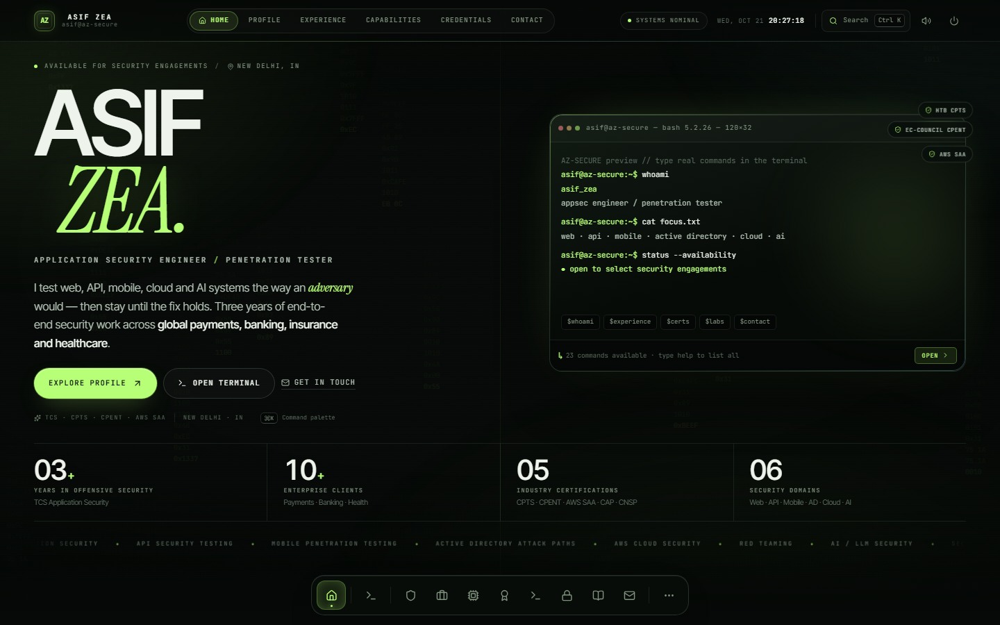
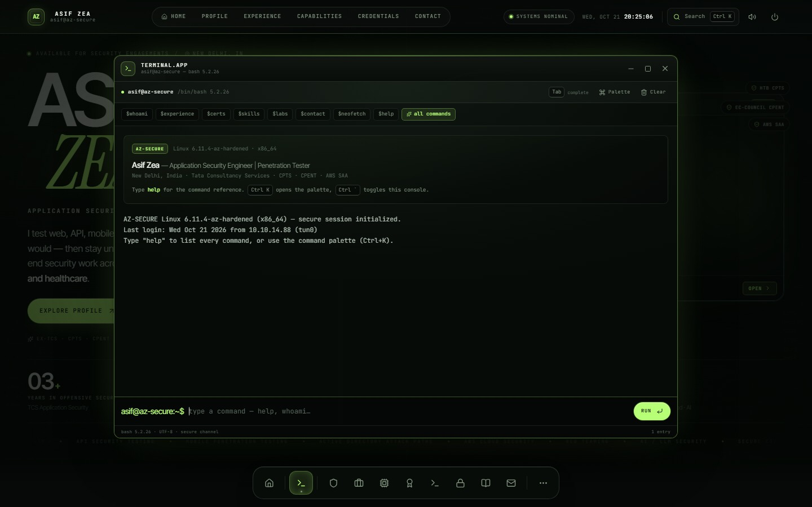
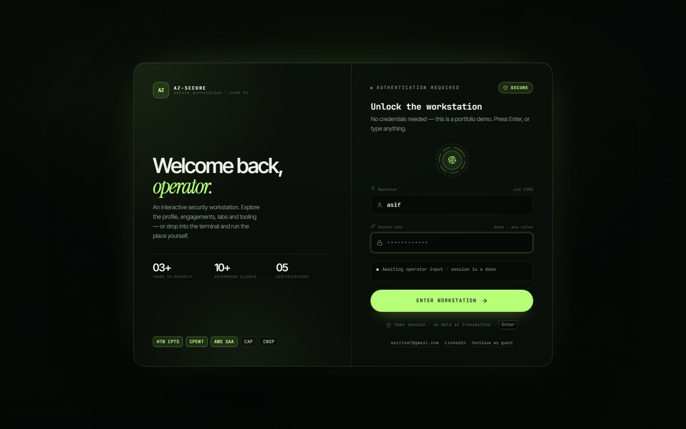
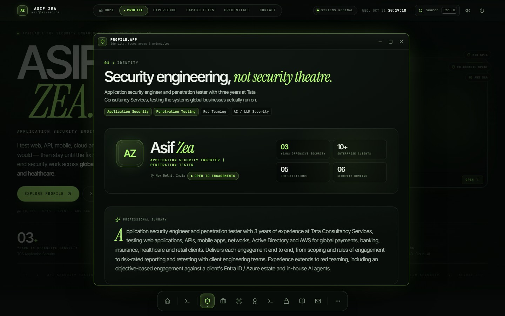
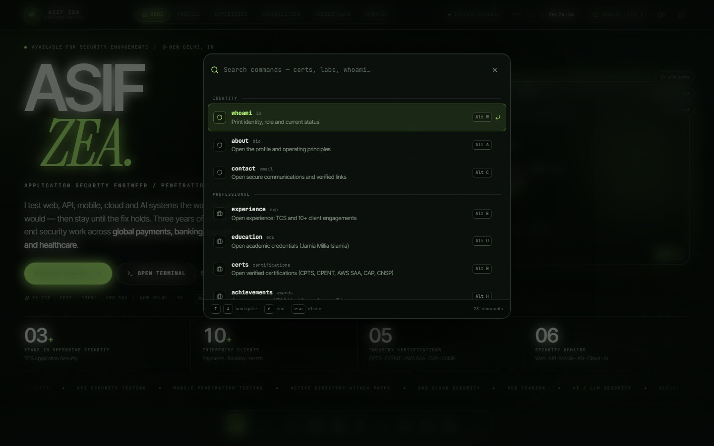
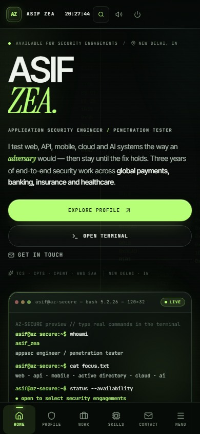

# Asif Zea — Interactive Security Workstation

[](https://react.dev/)
[](https://www.typescriptlang.org/)
[](https://vitejs.dev/)
[](https://motion.dev/)
[](LICENSE)

An interactive, browser-based security workstation and professional portfolio for **Asif Zea** — Application Security Engineer & Penetration Tester. Built with a bespoke desktop operating system metaphor, complete with a secure boot sequence, workstation unlock screen, multi-window desktop shell, live interactive bash terminal, command palette, and reactive cyber matrix background.

---

## 🖥️ Live Preview & Screenshots

| Desktop Workstation Home | Interactive Terminal Shell |
| :---: | :---: |
|  |  |

| Workstation Unlock | Profile & Credentials Module |
| :---: | :---: |
|  |  |

| Command Palette (`Ctrl/Cmd + K`) | Mobile Workstation View |
| :---: | :---: |
|  |  |

---

## ✨ Features

- **Boot Sequence (`AZ-BIOS`):** Realistic secure-boot sequence rendering the AZ emblem, system diagnostics, and hardware initialization in under 2 seconds (skippable via any keystroke or click).
- **Workstation Gate:** Cyberpunk-styled terminal login gate featuring an animated biometric fingerprint scanner and one-click direct workstation entry.
- **Centered Command Center Hero:** Clean, centered dual-column layout with high-impact typography, real-time typing bash console preview, quick-action chips, and key industry metrics.
- **Interactive Bash Shell:** 
  - 27+ built-in commands (`neofetch`, `whoami`, `cat`, `nmap`, `certs`, `labs`, `skills`, `clear`, `help`, etc.).
  - Perfectly aligned dual-column ASCII art `neofetch` output.
  - Tab completion, command history (`↑` / `↓`), inline execution hints, and auto-scrolling buffer.
- **Theme Switcher:** Instant runtime switching across 3 curated cyberpunk themes:
  - 🟢 **Matrix Green** (Phosphor terminal green)
  - 🔵 **Cyber Cyan** (Ice blue tech aesthetic)
  - 🟡 **Champagne Amber** (Refined warm golden hue)
- **Interactive Atmosphere:**
  - High-performance HTML5 Canvas matrix digital rain with real-time hex strings and column streams.
  - Subtle mouse-tracking radial beam glow with dynamic cursor lighting.
- **Multi-Window Desktop OS:**
  - 10 draggable, stackable, and maximizable window modules:
    - `About` — Bio, summary, and security domains
    - `Experience` — 3+ years at Tata Consultancy Services (TCS) across global banking, payments, and healthcare
    - `Certifications` — HTB CPTS, EC-Council CPENT, AWS SAA, SecOps CAP, SecOps CNSP
    - `Achievements` — TCS On the Spot Team Award, TCS HackQuest Season 7 Top 100
    - `Skills` — Web, Mobile, API, Active Directory, Cloud, AI/LLM Security
    - `Labs` — HackTheBox, Pro Labs, VulnHub, PortSwigger Web Security Academy
    - `Projects & Tools` — Custom security utilities, automation scripts, exploit writeups
    - `Methodology` — OWASP WSTG, MASTG, ASVS, NIST, PTES, MITRE ATT&CK
    - `Education` — B.Tech, Jamia Millia Islamia (2023)
    - `Contact` — Secure contact channel with local `mailto:` generator
- **Global Command Palette (`⌘K` / `Ctrl+K`):** Fuzzy-searchable index to quickly jump to any module or execute shell actions.
- **Audio Feedback System:** Subtle synthesised mechanical clicks and terminal beeps (with a global mute toggle in the top bar).
- **Deep Linking & Persistence:** URL hash navigation (`/#experience`, `/#certs`, `/#terminal`) and `sessionStorage` persistence across browser refreshes.

---

## ⌨️ Global Keyboard Shortcuts

| Shortcut | Description |
| :--- | :--- |
| `Ctrl` / `Cmd` + `K` | Toggle Command Palette |
| `Ctrl` + `` ` `` | Toggle Terminal Console |
| `Alt` + `1` – `9` | Launch corresponding window module |
| `Esc` | Close active modal, palette, or top-most window |
| `Tab` / `Shift+Tab` | Autocomplete command in Terminal |
| `↑` / `↓` | Navigate Terminal command history |

---

## 🛠️ Tech Stack

- **Core:** React 19, TypeScript 5.9
- **Build Tool:** Vite 8
- **Motion & Interactions:** Motion (Framer Motion v12)
- **Icons:** Lucide React
- **Sound:** Web Audio API synth oscillators (zero external audio file dependencies)
- **Styling:** Vanilla CSS design tokens with custom typography (Syne, Instrument Serif, JetBrains Mono)

---

## 🚀 Getting Started

### Prerequisites

- Node.js (v18.0.0 or higher recommended)
- npm or pnpm

### Installation

```bash
# Clone the repository
git clone https://github.com/shakilurrehman21/asif-zea-portfolio.git

# Enter project directory
cd asif-zea-portfolio

# Install dependencies
npm install
```

### Development

```bash
npm run dev
```

Visit `http://localhost:5173` to explore the workstation locally.

### Production Build

```bash
# Typecheck and build production bundle
npm run build

# Preview production build locally
npm run preview
```

---

## 📁 Project Structure

```text
asif-zea-portfolio/
├── preview/                     # Screenshots and visual media
├── public/                      # Static assets
├── src/
│   ├── commands/                # Terminal command registry and handlers
│   │   └── commandRegistry.ts   # 27+ executable shell commands
│   ├── components/              # Shell, window manager, and UI primitives
│   │   ├── apps/                # 10 dedicated application window modules
│   │   ├── ApplicationWindow.tsx# Draggable, resizable window frame
│   │   ├── BootSequence.tsx     # BIOS startup animation
│   │   ├── CommandPalette.tsx   # Global search palette
│   │   ├── CursorGlow.tsx       # Interactive mouse beam
│   │   ├── CyberBackground.tsx  # Matrix rain canvas
│   │   ├── DesktopHome.tsx      # Centered command center hero & console
│   │   ├── DesktopShell.tsx     # OS desktop orchestrator
│   │   ├── LoginScreen.tsx      # Terminal login gate
│   │   ├── SystemBar.tsx        # Top status bar & theme picker
│   │   ├── TerminalPanel.tsx    # Interactive terminal shell
│   │   └── WindowDock.tsx       # Bottom taskbar dock
│   ├── data/                    # Structured portfolio data and app configs
│   │   ├── apps.ts              # Window registry & metadata
│   │   └── portfolioData.ts     # Asif Zea's professional credentials
│   ├── styles/                  # Clean modular CSS architecture
│   │   ├── apps.css             # Window app styles
│   │   └── shell.css            # Desktop shell, topbar, dock, and windows
│   ├── types/                   # TypeScript interfaces
│   ├── utils/                   # Audio synth and theme manager
│   ├── App.tsx                  # Root stage controller (Boot -> Login -> Desktop)
│   ├── index.css                # CSS variables, typography, and reset
│   └── main.tsx                 # React entry point
├── .gitignore                   # Ignored files and build artifacts
├── index.html                   # HTML entry point with preload tags
├── package.json                 # Project dependencies & scripts
├── tsconfig.json                # TypeScript configuration
└── vite.config.ts               # Vite configuration
```

---

## 🔒 Security & Privacy Notice

All engagements, client identities, and vulnerability details conform to strict Non-Disclosure Agreements (NDAs). Case studies highlight methodologies and technical impact rather than proprietary client artifacts. The contact form operates purely client-side via a local `mailto:` handler; no telemetry, cookies, or remote tracking are used.

---

## 📄 License

This project is licensed under the [MIT License](LICENSE).
